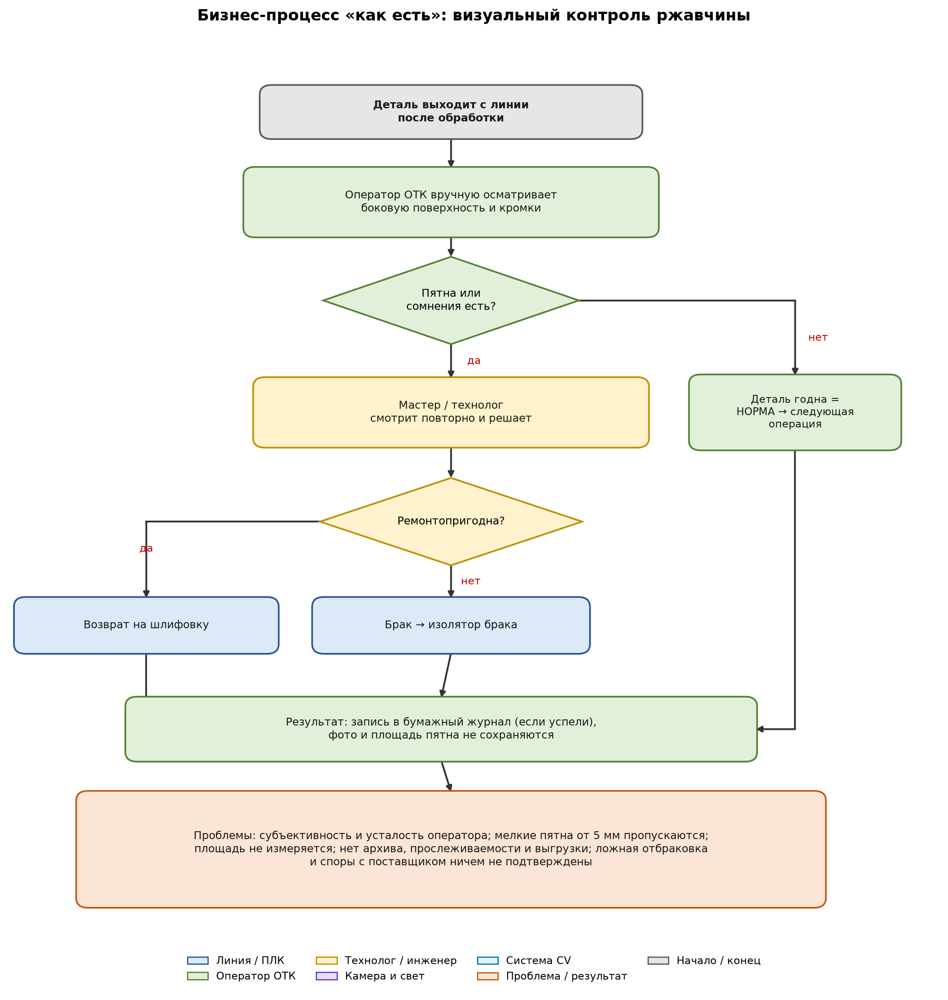
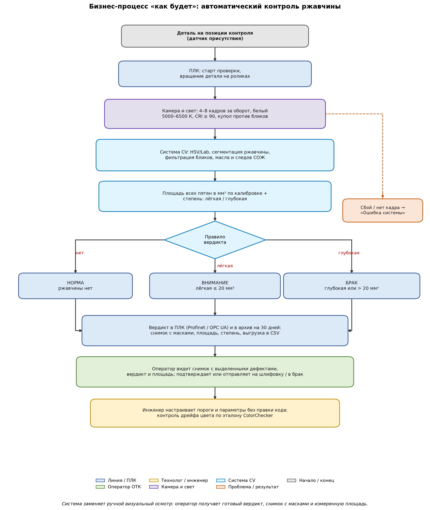

# КТ 1. Старт и бизнес-процессы

| Поле | Значение |
|---|---|
| Проект (ТЗ) | ТЗ 1. Система обнаружения ржавчины и коррозии (ПАО «ЧКПЗ») |
| Дата сдачи | [уточнить в Moodle] (в шаблоне указано 14.10.2026) |
| Капитан | [ФИО капитана] |
| Участники | [ФИО 1], [ФИО 2], [ФИО 3] |
| Репозиторий | [ссылка на Git-репозиторий] |

## 1. Команда и роли

| Участник | Роль | За что отвечает |
|---|---|---|
| [ФИО капитана] | Капитан, аналитик / PM | ТЗ и вопросы заказчику, бизнес-процессы, план-график, приёмка, отчёт и статья, коммуникация с заказчиком |
| [ФИО 2] | ML / CV-инженер | Обзор источников, датасет и разметка, обучение и сравнение моделей, метрики, инференс-сервис |
| [ФИО 3] | Backend / Frontend / DevOps | API и архив результатов, интерфейс оператора, Docker и `docker compose`, эмулятор ПЛК, CI, README |

Роли распределены так, чтобы у каждого был самостоятельный блок работы и один общий интеграционный этап (КТ 4). Капитан дополнительно ведёт репозиторий и следит за сроками.

## 2. Понимание задачи

**Цель проекта своими словами.** Автоматически находить ржавчину на всей боковой поверхности и кромках цилиндра после обработки, измерять её площадь, отличать лёгкую ржавчину от глубокой коррозии и выдавать вердикт прямо на линию — без ручного визуального осмотра.

**Что на входе.** Цветные снимки цилиндра: камера 5 МП с глобальным затвором, 4–8 кадров за оборот при вращении детали на роликах (или 3–4 камеры по кругу). Разрешение не хуже 0,2 мм/пиксель, белый свет 5000–6500 К, CRI ≥ 90, рассеянный купол против бликов.

**Что на выходе.**
- вердикт `НОРМА` / `ВНИМАНИЕ` / `БРАК` / `ОШИБКА СИСТЕМЫ`;
- снимок детали с выделенными пятнами ржавчины;
- суммарная площадь ржавчины в мм² и степень каждого пятна (лёгкая / глубокая);
- запись в архив (снимок + результат, хранение ≥ 30 дней, выгрузка в CSV);
- сигналы в ПЛК по Profinet или OPC UA.

**Критерии приёмки из ТЗ.**

| Критерий | Требование |
|---|---|
| Обнаружение пятен от 5 мм | recall ≥ 98% |
| Погрешность площади | ≤ ±15% |
| Правильная степень (лёгкая / глубокая) | ≥ 95% |
| Тестовая выборка | 200 деталей: 100 норма, 50 лёгкая ржавчина, 50 глубокая |
| Пропуск брака | ≤ 2% |
| Ложная отбраковка | ≤ 3% |
| Время проверки | не больше такта линии |
| Вердикты | «Норма», «Внимание», «Брак», «Ошибка системы» |
| Архив | ≥ 30 дней, выгрузка в CSV |
| Настройка порогов | инженером, без правки кода |
| Правило вердикта | нет ржавчины → норма; только лёгкая и ≤ 20 мм² → внимание; глубокая или > 20 мм² → брак |

## 3. Разбор ТЗ и вопросы к заказчику

**Заказчик:** НТЦ ПАО «ЧКПЗ», отдел компьютерного зрения. Основание — «Список кейсов», утв. Подберезко Д. С.

### 3.1. Что уже определено в ТЗ (не спрашиваем)

| Тема | Что сказано в ТЗ |
|---|---|
| Зона контроля | Вся боковая поверхность и кромки цилиндра |
| Время проверки | Не больше такта линии |
| Вердикты и интеграция | «Норма», «Внимание», «Брак», «Ошибка системы»; сигналы в ПЛК по Profinet или OPC UA |
| Классы ржавчины | Лёгкая (шелушится, матовая) и глубокая (ямки в металле) |
| Признаки | Цвет HSV/Lab, текстура (дисперсия, LBP), площадь по калибровке, степень |
| Ложные срабатывания | Блики, масло и следы СОЖ не должны считаться ржавчиной |
| Правило вердикта | Нет ржавчины → норма; только лёгкая и ≤ 20 мм² → внимание; глубокая или > 20 мм² → брак |
| Оборудование (предварительно) | Цветная камера 5 МП, глобальный затвор, GigE; ≤ 0,2 мм/пикс; свет 5000–6500 К, CRI ≥ 90; вращение на роликах 4–8 кадров или 3–4 камеры; ColorChecker |
| Интерфейс оператора | Снимок с выделенными дефектами, вердикт, измеренные размеры |
| Архив | Снимки и результаты ≥ 30 дней, выгрузка в CSV |
| Настройки | Пороги и параметры меняет инженер без правки кода |
| Приёмка | Пятна от 5 мм — ≥ 98%, площадь ±15%, степень ≥ 95%, 200 деталей (100/50/50), пропуск брака ≤ 2%, ложная отбраковка ≤ 3% |
| Защита оборудования | IP65 для камер и света, защита от пыли, СОЖ и вибрации |

Эти требования берём как есть и переносим в КТ 2–4, дублировать их в вопросах не нужно.

### 3.2. Открытые вопросы

Диаметр/длина/материал, такт линии и вращение детали прямо отмечены в ТЗ как открытые. Остальные вопросы — подтверждение неоднозначных мест и границ проекта.

| № | Вопрос | Зачем нужен ответ | Ответ заказчика |
|---|---|---|---|
| 1 | Диаметр, длина и материал цилиндра? | Расчёт оптики, числа камер и кадров на оборот (открытый вопрос ТЗ) | [заполнить] |
| 2 | Такт линии, сек/деталь? | Бюджет времени на съёмку и инференс (открытый вопрос ТЗ) | [заполнить] |
| 3 | Можно ли вращать деталь на позиции контроля на роликах? | Выбор схемы: 1 камера + вращение или 3–4 камеры по кругу (открытый вопрос ТЗ) | [заполнить] |
| 4 | Подтвердить: «лёгкая ржавчина, но суммарно > 20 мм²» — это брак? | В ТЗ сочетание не описано, принято как брак — нужно подтверждение | [заполнить] |
| 5 | Какой протокол ПЛК использовать: Profinet или OPC UA? | В ТЗ допущены оба, для прототипа и эмулятора нужен один | [заполнить] |
| 6 | Что делать при сбое: пропускать деталь, останавливать линию или звать оператора? | В ТЗ есть только сигнал «Ошибка системы», поведение линии не задано | [заполнить] |
| 7 | Предоставит ли заказчик 200 деталей для приёмки (100/50/50) и эталонные образцы? | Состав теста задан, но не сказано, кто даёт детали | [заполнить] |
| 8 | Будет ли доступ к линии для съёмки, монтажа и опытной эксплуатации? | Своих снимков нет, от этого зависит сбор данных и пусконаладка | [заполнить] |
| 9 | Кто отвечает за механику установки, IP65, защиту от вибрации и СОЖ? | Границы проекта: мы делаем ПО или установку целиком | [заполнить] |
| 10 | «Пропуск брака ≤ 2%» и «ложная отбраковка ≤ 3%» считаются по деталям или по пятнам? | Однозначные метрики для КТ 2–3 и приёмки | [заполнить] |

## 4. Бизнес-процесс «как есть»

**Участники:** оператор ОТК, мастер / технолог, линия и склад (изолятор брака). Системы нет — всё держится на людях и бумажном журнале.

**Шаги.**
1. Деталь выходит с линии после обработки.
2. Оператор ОТК вручную осматривает боковую поверхность и кромки.
3. Если пятна или сомнения есть — мастер / технолог смотрит повторно.
4. Решение: норма → следующая операция; ремонтопригодна → возврат на шлифовку; неремонтопригодна → изолятор брака.
5. Результат, если успели, записывается в бумажный журнал; фото и площадь не сохраняются.

**Проблемы.**
- Субъективность и усталость оператора: результат зависит от смены, освещения и опыта.
- Мелкие пятна от 5 мм пропускаются, площадь не измеряется — порог 20 мм² проверить нечем.
- Нет архива, фото и прослеживаемости: ложную отбраковку и спор с поставщиком нечем подтвердить.
- Время осмотра нестабильно и не привязано к такту линии.

## 5. Бизнес-процесс «как будет»

**Какой ручной шаг заменяет система.** Полностью заменяется ручной визуальный осмотр оператора и повторный осмотр мастером: система сама снимает деталь, находит ржавчину, измеряет площадь, определяет степень и формирует вердикт.

**Кто получает результат и что с ним делает.**
- **ПЛК линии** получает сигнал `Норма` / `Внимание` / `Брак` / `Ошибка системы` и передаёт деталь на следующую операцию, на шлифовку или в изолятор брака.
- **Оператор** видит на экране снимок с выделенными дефектами, вердикт и площадь; подтверждает спорные случаи и принимает решение по деталям «Внимание».
- **Инженер / технолог** настраивает пороги и параметры без правки кода, контролирует дрейф цвета по эталону и разбирает спорные снимки.
- **Архив** хранит снимки и результаты ≥ 30 дней; технолог и качество выгружают CSV для разбора и отчётности.

**Ожидаемый эффект.**
- Время проверки одной детали укладывается в такт линии, проверка не зависит от смены и усталости.
- Стабильное обнаружение пятен от 5 мм (recall ≥ 98%) и измеренная площадь вместо «на глаз».
- Меньше ложной отбраковки за счёт фильтрации бликов, масла и СОЖ.
- Появляются архив, прослеживаемость и объективные данные для разбора брака.

## 6. План-график

Даты ориентировочные (отсчёт от 17.11.2026) — скорректировать под дедлайны в Moodle.

| Этап | Ответственный | Срок | КТ |
|---|---|---|---|
| Разбор ТЗ, вопросы заказчику, схемы «как есть» / «как будет», репозиторий | [ФИО капитана] | Неделя 1: 17–23.11.2026 | КТ 1 |
| Обзор статей и готовых решений, выбор 3+ кандидатов | [ФИО 2] | Недели 2–3: 24.11–07.12.2026 | КТ 2 |
| Сбор и разметка датасета, метрики | [ФИО 2], [ФИО 3] | Недели 2–3: 24.11–07.12.2026 | КТ 2 |
| Обучение и сравнение моделей на одном железе | [ФИО 2] | Недели 4–5: 08–21.12.2026 | КТ 3 |
| Разбор ошибок, выбор лучшей модели | [ФИО 2], [ФИО капитана] | Неделя 5: 15–21.12.2026 | КТ 3 |
| Backend, архив, CSV, интерфейс оператора | [ФИО 3] | Недели 6–7: 22.12.2026–04.01.2027 | КТ 4 |
| Docker-образы, `docker compose up --build`, демо-сценарии | [ФИО 3], [ФИО 2] | Недели 6–7: 22.12.2026–04.01.2027 | КТ 4 |
| Итоговый отчёт, презентация, живое демо | Все | Неделя 8: 05–11.01.2027 | КТ 5 |
| Тема и тезисы статьи | [ФИО капитана] | Неделя 2: 24–30.11.2026 | Статья |
| Статья, проверка в «Думейте» | [ФИО капитана], все | Недели 5–8 | Статья |

## 7. Риски

| Риск | Что сделаем |
|---|---|
| Нет собственных снимков цилиндров, только открытые датасеты | Подбираем открытые наборы коррозии + аугментация; параллельно договариваемся о съёмке на линии. План Б — few-shot дообучение на 20–50 своих кадрах |
| Доменный сдвиг: ржавчина на цилиндрах не похожа на открытые фото | Смешиваем открытые данные со своими, проверяем на отложенной «своей» выборке, оставляем классический HSV/Lab-метод как baseline |
| RTX 3060 Laptop, 6 ГБ VRAM | Лёгкие модели (YOLOv8n/s-seg, SegFormer-B0), вход 512–640 px, AMP, batch 2–4; при нехватке — обучение в Colab, инференс на CPU |
| Блики, масло, СОЖ дают ложную ржавчину | Купол / поляризация, маска бликов, отдельный класс «не дефект», проверка на реальных кадрах |
| Нет доступа к ПЛК и линии | Эмулятор ПЛК (OPC UA / Modbus), офлайн-демо на видео и папке снимков; интеграция описывается в отчёте |
| Разметка субъективна (граница лёгкая / глубокая) | Гайдлайн разметки, двойная разметка части кадров, калибровка с технологом, метрика согласия |
| Сроки: сессия и Новый год | MVP делаем раньше (КТ 3), резерв — неделя перед защитой, демо-видео записываем заранее |
| Требование 0% ИИ в статье | Пишем текст сами, ИИ используем только для поиска источников и вычитки; проверяем в «Думейте» до сдачи |

## 8. Допущения и границы проекта

| Допущение | Как влияет на работу |
|---|---|
| Своих снимков цилиндров пока нет | До получения доступа к линии используем открытые датасеты коррозии и аугментацию; приёмка на 200 реальных деталях — этап опытной эксплуатации |
| Прототип работает офлайн: папка снимков или видео | ПЛК эмулируем по OPC UA; реальный ПЛК подключаем на этапе интеграции |
| Разрешение съёмки ≤ 0,2 мм/пикс и калибровочная мишень доступны | Без калибровки площадь в мм² и порог 20 мм² не гарантируются |
| Механику, свет, IP65, монтаж и пусконаладку не изготавливаем | Это граница с заказчиком (вопрос 9), в проекте — только ПО и схема установки |
| «Лёгкая ржавчина > 20 мм² = брак» принимаем по ТЗ как рабочее правило | Действует до подтверждения заказчиком (вопрос 4) |

## 9. Исходные материалы

- `filesfromcourse/ТЗ на системы техзрения ржавчина, недообработка, заусенцы.pdf` — раздел «ТЗ 1. Система обнаружения ржавчины и коррозии».
- `filesfromcourse/КТ 1. Старт и бизнес-процессы.docx` — шаблон задания.
- `filesfromcourse/Методичка как писать статьи по ИИ.pdf`, `Как писать тезисы статьи.pdf` — для этапа статьи.

## Чек-лист сдачи

- [x] У каждого участника есть роль и задачи
- [x] Схемы «как есть» и «как будет» готовы
- [x] Понятно, какой ручной шаг заменяет система
- [x] План покрывает все пункты ТЗ
- [x] Репозиторий создан, есть README
- [ ] Заполнить ФИО, ссылку на репозиторий и ответы заказчика
