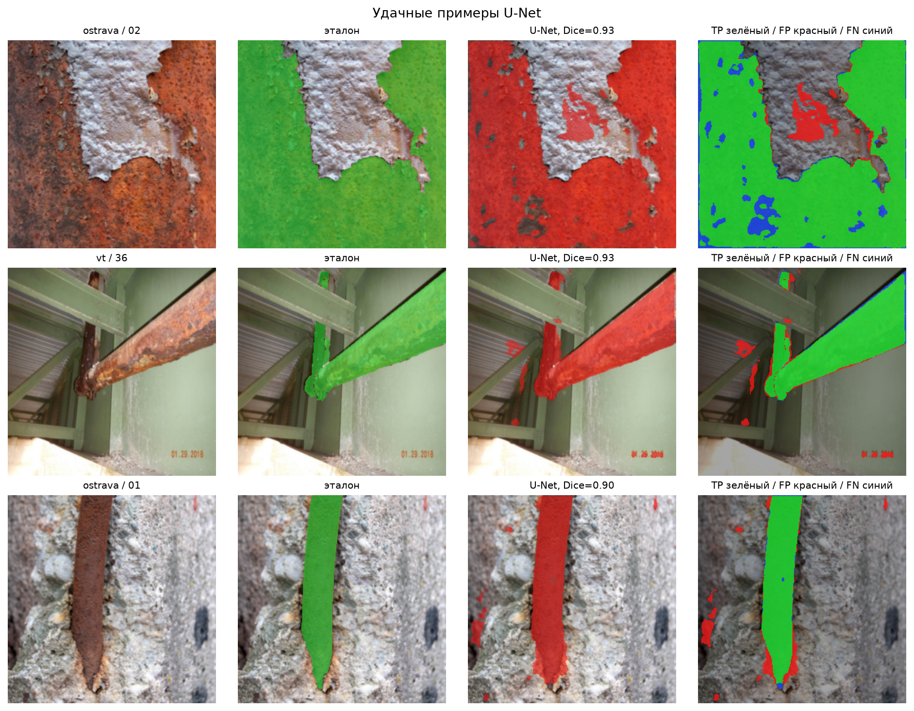
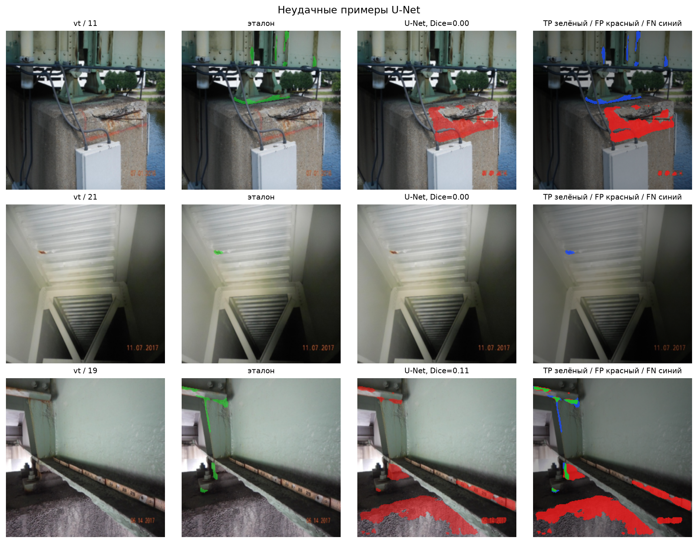

# КТ 3. Эксперименты

**ТЗ 1. Система обнаружения ржавчины и коррозии (ПАО «ЧКПЗ»)**

| Поле | Значение |
|---|---|
| Проект (ТЗ) | ТЗ 1. Система обнаружения ржавчины и коррозии (ПАО «ЧКПЗ») |
| Дата сдачи | 18.11.2026 |
| Капитан | Райимжонов Абдусамад Тулкинович |
| Участники | Индивидуальная работа. Все этапы проекта выполняются самостоятельно |
| Репозиторий | https://github.com/RvadRA/rust-corrosion-detection |

## 1. Железо

| Компонент | Значение |
|---|---|
| Видеокарта | NVIDIA GeForce RTX 3060 Laptop GPU |
| VRAM, ГБ | 6 |
| RAM, ГБ | 16 |
| Процессор | AMD Ryzen 7 5800H |
| ОС, версии библиотек | Windows 11; Python 3.14.2; NumPy 2.5.4; scikit-learn 1.9.1; SciPy 1.18.1; PyTorch 2.15.0+cpu |

Эксперименты запущены на CPU: установлен PyTorch CPU-only, видеокарта не использовалась. Это сделано для воспроизводимости на машине без CUDA; VRAM в таблице равна 0. Для обучения на GPU нужен PyTorch CUDA и отдельный прогон.

## 2. Условия эксперимента

### 2.1. Тестовые данные

| Выборка | Всего | Ostrava | Virginia Tech | Pipelines |
|---|---:|---:|---:|---:|
| Train | 541 | 75 | 396 | 70 |
| Val | 35 | 15 | 0 | 20 |
| Test | 79 | 15 | 44 | 20 |

Все методы проверены на одном и том же test: 79 изображений, 256×256, бинарные маски «ржавчина / фон». Ostrava и VT используют авторские split; pipelines разделены 70/20/20 по seed 42. Пересечений по изображениям между train/val/test нет, test заморожен до обучения. Класса «норма» и разметки степени «лёгкая/глубокая» в открытых данных нет, поэтому оценивалась только бинарная сегментация.

**Ограничение validation.** В validation всего 35 изображений: Ostrava 15 и Pipelines 20. Virginia Tech в validation отсутствует полностью. Поэтому пороги HSV/Lab, порог RandomForest и выбор лучшей эпохи U-Net настраивались без VT, а все метрики VT — только на test. Это не позволяет считать VT-результат независимой валидацией гиперпараметров.

### 2.2. Обозначения методов

Фактически выполненные методы перенумерованы в M1–M4:

| Код | Метод |
|---|---|
| M1 | HSV-порог |
| M2 | Lab-порог |
| M3 | RandomForest цвет+текстура |
| M4 | U-Net |

E0–E7 — это первоначальный план экспериментов из КТ 2; обозначения E0–E7 сохраняются за планом и не переиспользуются для фактических прогонов.

### 2.3. Настройки

- Seed 42, вход 256×256, маски — nearest-neighbor, изображения — bilinear.
- Пороги HSV/Lab и порог вероятности подбирались только на val (35 изображений), затем один раз применялись к test.
- HSV: hue 0,00–0,10 и 0,92–1,00; S ≥ 0,20; V ≥ 0,15; V ≤ 1,00.
- Lab: a ≥ 5; b ≥ 0; L ≤ 100.
- RandomForest: 80 деревьев, глубина 16, min_samples_leaf 5, по 1500 положительных и 1500 отрицательных пикселей с изображения; признаки RGB, HSV, Lab, локальные средние 9×9, локальное СКО, градиент, red excess; порог 0,65; морфология 3×3 и удаление компонент < 24 px.
- U-Net: 1,94 млн параметров, каналы 16–32–64–128, bottleneck 256; 12 эпох, batch 8, AdamW, lr 1e-3, BCE + Dice, аугментация поворотами и отражениями; лучшая эпоха 8; порог 0,50; та же морфология.
- Метрики: pixel precision, recall, F1, Dice, IoU, относительная ошибка площади. FPS — обработка test на CPU, без учёта загрузки модели.

### 2.4. Скрипт для повтора

```bash
python src/ml/kt3/prepare_data.py
python src/ml/kt3/run_thresholds.py
python src/ml/kt3/run_rf.py
python src/ml/kt3/run_unet.py --epochs 12
python src/ml/kt3/benchmark.py
python src/ml/kt3/run_spots.py
python src/ml/kt3/audit_metrics.py
python src/ml/kt3/make_examples.py
python docs/kt3/make_docx.py
```

## 3. Результаты сравнения

| Модель / метод | Precision (micro) | Recall (micro) | F1 (micro) | Dice / IoU (macro) | FPS | VRAM / RAM, ГБ |
|---|---:|---:|---:|---:|---:|---:|
| M1. HSV-порог | 0,468 | 0,668 | 0,551 | 0,533 / 0,405 | 201,5 | 0 / 0,31 |
| M2. Lab-порог | 0,523 | 0,614 | 0,564 | 0,534 / 0,406 | 105,2 | 0 / 0,31 |
| M3. RandomForest цвет+текстура | 0,589 | 0,662 | 0,623 | 0,582 / 0,450 | 10,6 | 0 / 0,51 |
| M4. U-Net | 0,599 | 0,661 | 0,629 | 0,585 / 0,452 | 17,6 | 0 / 0,69 |

| Модель / метод | F1 all (micro) | Ошибка площади | Ostrava F1 (micro) | VT F1 (micro) | Pipelines F1 (micro) |
|---|---:|---:|---:|---:|---:|
| M1. HSV-порог | 0,551 | 172% | 0,628 | 0,496 | 0,634 |
| M2. Lab-порог | 0,564 | 125% | 0,638 | 0,513 | 0,620 |
| M3. RandomForest | 0,623 | 120% | 0,749 | 0,567 | 0,624 |
| M4. U-Net | 0,629 | 122% | 0,663 | 0,612 | 0,629 |

| Метрика ТЗ | Цель | Факт | Вывод |
|---|---:|---:|---|
| Recall пятен от 5 мм | ≥ 98% | 15,6% (spot-level, IoU ≥ 0,5) | Не достигнуто; нужен тест в нативном разрешении |
| Ошибка площади | ≤ 15% | 120–172% (M3–M4: 120–122%) | Не достигнуто; мелкие маски и доменный сдвиг |
| Точность степени | ≥ 95% | не оценивалась | В открытых данных нет меток «лёгкая/глубокая» |
| Точность вердикта | ≥ 95% | не оценивалась | Нет трёхклассовой разметки и калибровки мм/пиксель |
| Тест на 200 деталях | 100/50/50 | 79 изображений | Приёмочный тест не проводился |

**Аудит метрик.** `benchmark.py` не считает F1/Dice/IoU: он измеряет только FPS и RSS. Качество считается в `common.summarize()`. Precision, Recall и F1 — micro-усреднение по пикселям: `F1 = 2TP / (2TP + FP + FN)`. Dice и IoU — macro-среднее по 79 изображениям: сначала Dice/IoU каждого кадра, затем среднее. `F1 micro` численно совпадает с `Dice micro`, но в таблице стоит `Dice macro`, поэтому F1 ≠ Dice — это разные способы усреднения, а не ошибка. Для M1: F1 micro 0,5505, Dice macro 0,5334, IoU macro 0,4052, IoU micro 0,3798. Пересчёт по сохранённым `tp/fp/fn` выполнен в `audit_metrics.py`, результат — `docs/kt3/results/metrics_audit.json`, расхождений с сохранёнными значениями нет (`status: ok`).

Лучший результат по F1 (micro) и Dice/IoU (macro) — M4 U-Net: F1 0,629, Dice 0,585, IoU 0,452. M3 RandomForest отстаёт на 0,005 F1 (micro), но заметно лучше на Ostrava (0,749 против 0,663) и хуже на VT (0,567 против 0,612). U-Net более сбалансирован по источникам, поэтому выбран для прототипа. Пороговые методы проигрывают по точности, но дают интерпретируемый fallback и работают на порядки быстрее.

Ошибка площади 120–122% у M3–M4 — средняя относительная ошибка по изображениям; она сильно завышена кадрами с маленькими масками, где несколько лишних пикселей дают сотни процентов. У M1–M2 ошибка выше — 172% и 125% соответственно. Для приёмки нужна площадь по детали и калибровка мм/пиксель, а не средняя по кадрам.

На уровне пятен (IoU ≥ 0,5, компоненты ≥ 24 px) M4 даёт recall 15,6% и precision 12,4%; у M3 recall 19,8% при precision 8,1%, у M1/M2 — 18,0–19,8% при precision 6,8–7,1%. Pixel F1 не равен обнаружению пятен: крупные пятна дают много пикселей и завышают общую картину.

Целевые 98% recall и ±15% площади на этом прогоне не достигнуты. Причины: открытые датасеты сняты на мостах и трубах, а не на цилиндрах; нет класса «норма» и hard negatives; 5-мм пятно при downsample до 256 px теряет пиксели; U-Net обучен на CPU всего 12 эпох без предобученного энкодера. Это промежуточный результат, а не приёмочный.

## 4. Примеры

### 4.1. Удачные примеры



- **Ostrava / 02, Dice 0,93.** Крупное пятно с ярким оранжево-коричневым цветом и чёткой границей; ошибки только по краям шелушения.
- **VT / 36, Dice 0,93.** Ржавая труба на зелёном фоне; модель уверенно отделяет трубу от фона, слегка теряет дальний тонкий конец.
- **Ostrava / 01, Dice 0,90.** Вертикальная ржавая полоса на бетоне; граница размыта, но площадь и положение переданы верно.

### 4.2. Неудачные примеры



- **VT / 11, Dice 0,00.** Эталон — тонкая ржавая полоса по верхней балке и небольшое пятно на выступе. Модель размечает широкое пятно на бетоне: цвет бетона близок к ржавчине, тонкие структуры теряются.
- **VT / 21, Dice 0,00.** Маленькое пятно на белой балке (78 px в маске). После downsample до 256 px объект становится меньше эффективного рецептивного поля и пропускается.
- **VT / 19, Dice 0,11.** Эталон — тонкая ржавая линия по фланцу. Модель переразмечает тёмную влажную/ржавую нижнюю зону и кабель, путая тень и тёмный металл с коррозией.

## 5. Промежуточные выводы

- **Лучший вариант:** M4 U-Net (1,94 млн параметров) — лучший F1 (micro) и Dice/IoU (macro), более ровное качество на трёх источниках. Для прототипа берём U-Net; M3 RandomForest оставляем как интерпретируемый baseline, M1/M2 HSV/Lab — как быстрый fallback.
- **Целевые метрики ТЗ не достигнуты.** 98% recall пятен и ±15% площади требуют нативного разрешения, собственной съёмки цилиндров, разметки степени и калибровки мм/пиксель. На открытых данных получен только диагностический уровень F1 ≈ 0,63.
- **Ограничение validation:** 35 изображений, VT отсутствует; пороги и early stopping на VT не проверялись.
- **Что улучшить к прототипу:**
  1. Снять 300 чистых кадров и 20–50 деталей, добавить блики и царапины.
  2. Обучать на нативном разрешении или на crop'ах 512–1024 px, а не на 256 px.
  3. Взять предобученный энкодер (ResNet-34/EfficientNet-B0), больше эпох и GPU; добавить TTA.
  4. Добавить голову степени «лёгкая/глубокая» и калибровку площади по эталону.
  5. Проверить YOLOv8-seg, SegFormer-B0 и PatchCore на том же test; сейчас они не запускались.
  6. Сделать cross-dataset тест и приёмочный тест на 200 реальных деталях (100/50/50).

## Чек-лист сдачи

- ☒ M1–M4 запущены на одних и тех же данных
- ☒ Таблица сравнения заполнена полностью
- ☒ Метрики посчитаны кодом из репозитория
- ☒ Описано железо
- ☒ Выбран лучший вариант для прототипа
- ☐ YOLOv8-seg, SegFormer-B0 и PatchCore не запущены — следующий этап
- ☐ Приёмочные 98% / ±15% / 200 деталей не проверены — нужны свои данные
- ☐ VT отсутствует в validation — ограничение сохраняется
