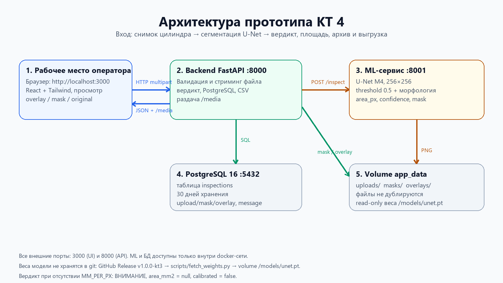
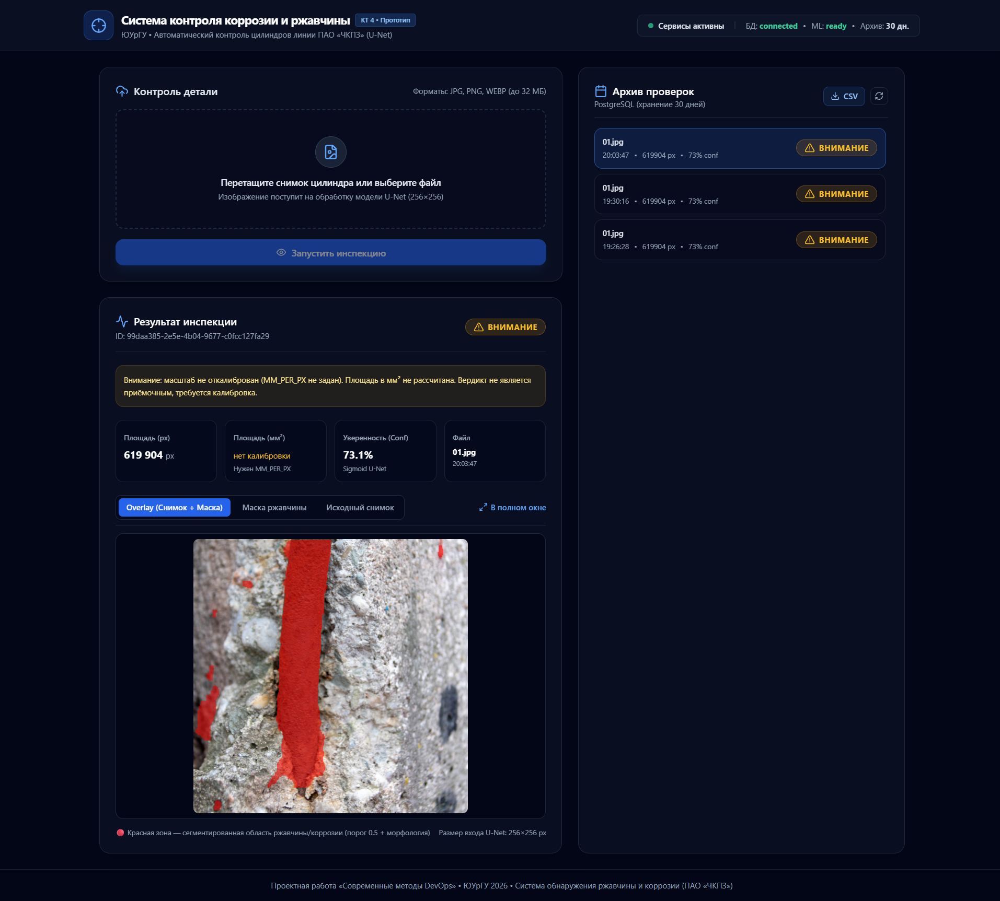

# КТ 4. Прототип

**ТЗ 1. Система обнаружения ржавчины и коррозии (ПАО «ЧКПЗ»)**

| Поле | Значение |
|---|---|
| Проект (ТЗ) | ТЗ 1. Система обнаружения ржавчины и коррозии (ПАО «ЧКПЗ») |
| Дата сдачи | 19.11.2026 |
| Капитан | Райимжонов Абдусамад Тулкинович |
| Участники | Индивидуальная работа. Все этапы проекта выполняются самостоятельно |
| Репозиторий | https://github.com/RvadRA/rust-corrosion-detection |

## 1. Выбранное решение

- **Модель / связка методов:** U-Net M4 для бинарной сегментации ржавчины + FastAPI + PostgreSQL + React. Модель работает на CPU, вход 256×256 RGB, порог 0,5, морфологическая постобработка и удаление компонент меньше 24 px.
- **Почему именно она:** в КТ 3 U-Net M4 показала лучший F1 micro (0,6285) и Dice/IoU macro (0,5849 / 0,4515). RandomForest M3 отстал всего на 0,005 F1, но заметно хуже на Virginia Tech (0,567 против 0,612) и менее устойчив к доменному сдвигу. U-Net даёт более ровное качество на Ostrava, Virginia Tech и Pipelines, поэтому выбрана для прототипа. HSV/Lab оставлены как быстрый интерпретируемый fallback. Подробности — в `docs/kt3/kt3.md` и `docs/kt3/results/unet.json`.

| Часть | Технология | Кто делал |
|---|---|---|
| Данные и модель | Python 3.11, PyTorch 2.3.1+cpu, NumPy, SciPy, Pillow, U-Net M4 | Райимжонов А. Т. |
| Backend | FastAPI, SQLAlchemy, PostgreSQL 16, httpx, Pillow | Райимжонов А. Т. |
| Frontend | React, Vite, Tailwind CSS, Lucide Icons, Nginx | Райимжонов А. Т. |
| Инфраструктура | Docker, Docker Compose, multi-stage, healthchecks | Райимжонов А. Т. |
| Исследование | M1–M4, метрики, аудит, подготовка данных | Райимжонов А. Т. |

## 2. Устройство прототипа



**Путь «вход → результат».**

1. Оператор загружает снимок цилиндра через браузер (`http://localhost:3000`) или отправляет его в `POST /api/v1/inspect`.
2. Backend принимает файл потоково, проверяет расширение, размер до 32 МБ и целостность изображения через Pillow. Исходник сохраняется в `uploads/{inspection_id}_{filename}`.
3. Backend вызывает ML-сервис по внутреннему адресу `http://ml:8001/inspect`, передавая `inspection_id` и, если задан, `mm_per_px`. ML-сервис обрабатывает исходник через временный файл и сразу удаляет его, чтобы не создавать дубликаты.
4. U-Net возвращает маску, overlay, `area_px`, `confidence` и признак калибровки `calibrated`. Маска и overlay сохраняются в общие volume-каталоги `masks/` и `overlays/` под ID инспекции.
5. Backend рассчитывает вердикт:
   - площадь 0 px → `НОРМА`;
   - `MM_PER_PX` не задан → `ВНИМАНИЕ`, `area_mm2 = null`, `calibrated = false`, в сообщении предупреждение о некалиброванной площади;
   - площадь ≤ 20 мм² → `ВНИМАНИЕ`;
   - площадь > 20 мм² → `БРАК`.
6. Запись сохраняется в PostgreSQL. Интерфейс показывает overlay, маску или исходник, вердикт, площадь, уверенность и журнал проверок; CSV выгружается с UTF-8 BOM для Excel.
7. Retention-задача при старте и каждые 12 часов удаляет записи и связанные файлы старше 30 дней.

**Основные компоненты.**

| Компонент | Назначение |
|---|---|
| `frontend` | Панель оператора: загрузка, результат, история, переключение overlay/mask/original, CSV, индикатор health |
| `backend` | REST API, валидация, бизнес-логика вердиктов, PostgreSQL, CSV, раздача `/media`, retention |
| `ml` | Изолированный сервис инференса U-Net, multipart, временные файлы, маска и overlay |
| `db` | PostgreSQL 16, таблица `inspections`, хранение метаданных и путей к файлам |
| `app_data` | Общий volume: `uploads/`, `masks/`, `overlays/` |

**API прототипа.**

| Метод | Путь | Назначение |
|---|---|---|
| GET | `/health` | Статус backend, БД и ML |
| POST | `/api/v1/inspect` | Загрузка снимка и запуск инспекции |
| GET | `/api/v1/results` | Журнал проверок с пагинацией |
| GET | `/api/v1/results/{id}` | Одна запись по ID |
| GET | `/api/v1/results.csv` | Выгрузка журнала в CSV (UTF-8 BOM, `;`) |
| GET | `/media/...` | Исходники, маски и overlay |

## 3. Как запустить

**Требования:** Docker Desktop или Docker Engine с Compose, Git, Python 3.10+ для скрипта загрузки весов, 4 ГБ свободной RAM. GPU не требуется: инференс идёт на CPU. Проверено на Windows 11 и Docker Desktop.

```bash
git clone https://github.com/RvadRA/rust-corrosion-detection.git
cd rust-corrosion-detection

cp .env.example .env

python scripts/fetch_weights.py

docker compose up --build -d
docker compose ps
curl http://localhost:8000/health
```

Для Windows PowerShell вместо `cp`:

```powershell
Copy-Item .env.example .env
```

Ожидаемый `health`:

```json
{
  "status": "ok",
  "db": "connected",
  "ml": "ready",
  "retention_days": 30,
  "timestamp": "..."
}
```

Адреса:

- интерфейс оператора — `http://localhost:3000`;
- OpenAPI/Swagger — `http://localhost:8000/docs`;
- проверка API — `http://localhost:8000/health`.

Остановка:

```bash
docker compose stop
docker compose down
docker compose down -v   # с удалением томов БД и медиа
```

Подробная инструкция: [README.md](../../README.md).

### 3.1. Docker-образы

Прототип сдаётся в Docker и должен подниматься одной командой на чистом компьютере:

```bash
git clone https://github.com/RvadRA/rust-corrosion-detection.git && cd rust-corrosion-detection
cp .env.example .env
python scripts/fetch_weights.py
docker compose up --build
```

**Выполнение требований к образам.**

- ☒ На каждый сервис свой Dockerfile, все сервисы описаны в `docker-compose.yml`.
- ☒ Версии зафиксированы: `python:3.11-slim-bookworm`, `postgres:16-alpine`, `node:20-alpine3.20`, `nginx:1.27.0-alpine`; Python-зависимости — в `requirements.txt`, frontend — в `package-lock.json`.
- ☒ Есть `.dockerignore`; ML, backend и frontend собираются в multi-stage.
- ☒ Веса не лежат в git: скачиваются `scripts/fetch_weights.py` и подключаются томом `./dataset/processed/kt3/unet.pt:/models/unet.pt:ro`; путь задаётся через `MODEL_PATH`.
- ☒ Настройки — через переменные окружения, есть `.env.example`; `.env` и веса исключены из git.
- ☒ GPU не нужна: используется CPU-only PyTorch. CUDA-режим не требуется и не описан как обязательный.
- ☒ Приложение запускается не от root: `appuser` в ML/backend, `nginx` во frontend; логи — в stdout; у всех сервисов есть healthcheck.
- ☒ В README описаны требования, запуск, остановка, адреса и порты.

| Сервис | Dockerfile | Базовый образ | Порт | Нужна GPU | Размер образа, ГБ |
|---|---|---|---|---|---|
| ML / CV | `docker/ml.Dockerfile` | `python:3.11-slim-bookworm` | 8001, только внутри сети | нет | 1,74 |
| Backend | `docker/backend.Dockerfile` | `python:3.11-slim-bookworm` | 8000, внешний | нет | 0,38 |
| Frontend | `docker/frontend.Dockerfile` | `node:20-alpine3.20` → `nginx:1.27.0-alpine` | 3000, внешний | нет | 0,07 |
| PostgreSQL | официальный образ | `postgres:16-alpine` | 5432, только внутри сети | нет | 0,42 |

**Фактическое состояние локального запуска:** все четыре контейнера — `healthy`; `corrosion_frontend` доступен на `3000`, `corrosion_backend` — на `8000`, `corrosion_ml` и `corrosion_db` — только внутри docker-сети.

Чистый старт подтверждён: GitHub Release `v1.0.0-kt3` доступен (HTTP 302), `scripts/fetch_weights.py` в пустом каталоге завершился с кодом 0, SHA-256 совпал, `docker compose up --build` поднял четыре контейнера в состоянии `healthy`.

## 4. Демо-сценарии

Проверенные сценарии и фактические результаты:

| Сценарий | Ожидаемый результат | Фактический результат | Пройден |
|---|---|---|---|
| Загрузка `01.jpg` через UI | Карточка результата, overlay, запись в журнале | HTTP 200; `area_px = 619904`, `confidence = 0.7307`, `area_mm2 = null`, `calibrated = false`, вердикт `ВНИМАНИЕ`; запись появилась в журнале | да |
| `POST /api/v1/inspect` с `01.jpg` | JSON с полями маски и overlay | 200; те же `area_px` и `confidence`; `original_url`, `mask_url`, `overlay_url` отдаются | да |
| Невалидный файл `README.md` | HTTP 415 | HTTP 415, сообщение о неподдерживаемом формате | да |
| Повреждённый JPEG | HTTP 400 | HTTP 400, сообщение о повреждённом изображении | да |
| Медиа для всех записей журнала | `original_url`, `mask_url`, `overlay_url` → 200 | 4 записи; все три URL для каждой записи → 200 | да |
| `GET /api/v1/results.csv` | 200, UTF-8 BOM, разделитель `;` | 200, 538 байт, BOM присутствует, заголовки и строки корректны | да |
| ML-сервис недоступен | HTTP 503, понятная ошибка | 503; ML-сервис недоступен, после старта `ml` → `healthy` | да |
| Retention 30 дней | Старые записи и файлы удаляются | Тестовая запись состарена на 31 день; после restart backend → 404, upload/mask/overlay удалены | да |
| `MM_PER_PX` задан | `area_mm2` рассчитана, вердикт по порогу 20 мм² | При `MM_PER_PX=0,1`: `area_mm2 = 6199,04`, `calibrated = true`, вердикт `БРАК` | да |
| Чистый запуск на другой машине | `docker compose up --build` → 4 healthy | Release `v1.0.0-kt3` доступен, `fetch_weights.py` скачал веса с совпавшим SHA-256, 4 контейнера healthy | да |

Проверки ML down, retention и `MM_PER_PX` выполнены 19.11.2026; retention — на синтетически состаренной тестовой записи. После проверок в БД остались 4 валидные записи.

Сценарий с UI технически пройден; вердикт не является приёмочным, так как `MM_PER_PX` не задан.



На скриншоте: загрузка снимка, вердикт `ВНИМАНИЕ`, overlay с красной маской, площадь в пикселях, уверенность 73,1 % и журнал проверок. Так как `MM_PER_PX` не задан, площадь в мм² не рассчитывается, а вердикт сопровождается предупреждением и не является приёмочным.

## 5. Метрики на прототипе

Качество модели ниже — это метрики U-Net M4 на замороженном test из КТ 3 (79 изображений). Это тот же чекпоинт, который используется в прототипе. Это не приёмочный тест на 200 деталях.

| Метрика | Цель из ТЗ | Факт |
|---|---:|---:|
| Recall пятен от 5 мм (spot-level, IoU ≥ 0,5) | ≥ 98 % | 15,6 % — не достигнуто |
| Ошибка площади | ≤ 15 % | 122 % — не достигнуто |
| Точность степени «лёгкая / глубокая» | ≥ 95 % | Не оценивалась: нет разметки степени |
| Точность вердикта | ≥ 95 % | Не оценивалась: нет трёхклассовой разметки и калибровки |
| Приёмочный тест на 200 деталях (100 / 50 / 50) | 100 / 50 / 50 | Не проводился: test — 79 изображений |
| Pixel F1 micro (диагностическая) | Не задана в ТЗ | 0,6285 |
| Pixel Precision / Recall (micro) | Не заданы в ТЗ | 0,5991 / 0,6609 |
| Mean Dice / IoU (macro) | Не заданы в ТЗ | 0,5849 / 0,4515 |
| Скорость инференса на CPU | Не задана в ТЗ | 17,6 FPS (KT 3, test) |

**Инженерные проверки прототипа.**

| Проверка | Ожидание | Факт | Статус |
|---|---|---|---|
| `docker compose ps` | 4 сервиса healthy | 4/4 healthy | да |
| `GET /health` | `status = ok`, БД и ML доступны | `db = connected`, `ml = ready`, retention 30 дней | да |
| UI «вход → результат» | Результат без ручных шагов | Загрузка, инспекция, overlay и запись в журнале | да |
| Валидация расширения | 415 | 415 | да |
| Валидация повреждённого изображения | 400 | 400 | да |
| CSV | 200 + UTF-8 BOM | 200, BOM есть | да |
| Медиа всех записей | 200 | 4 записи, все URL 200 | да |
| Чистый запуск по README | 4 healthy на чужой машине | `fetch_weights.py` — код 0, SHA-256 OK; 4 контейнера healthy | да |
| ML down | 503 | 503; после старта `ml` → `healthy` | да |
| Retention | Удаление старше 30 дней | Тестовая запись 31 день: 404, upload/mask/overlay удалены | да |
| `MM_PER_PX` | `area_mm2` и `calibrated` | 0,1 мм/px: 6199,04 мм², `calibrated = true`, `БРАК` | да |

**Вывод по метрикам.** Прототип технически проходит путь «вход → результат», но целевые метрики ТЗ не достигнуты. F1 около 0,63 — диагностический уровень, а не приёмочный. Основные причины: доменный сдвиг открытых датасетов, отсутствие собственных снимков цилиндров ЧКПЗ, отсутствие чистых негативных кадров, downsample до 256 px и обучение U-Net на CPU всего 12 эпох.

## 6. Известные ограничения

1. **Качество сегментации недостаточно для приёмки.** Recall пятен 15,6 % при цели ≥ 98 %, ошибка площади 122 % при цели ≤ 15 %. Модель обучена на открытых данных (Ostrava, Virginia Tech, Pipelines), а не на цилиндрах ЧКПЗ.
2. **Нет классификатора степени и трёхклассового вердикта.** Разметка «лёгкая / глубокая» отсутствует, поэтому `БРАК` по степени и точность вердикта ≥ 95 % не проверены.
3. **Нет автоматической калибровки мм/пиксель.** Механизм `MM_PER_PX` проверен: при `0,1` мм/px площадь `6199,04` мм², `calibrated = true`, вердикт `БРАК`. Но значение задаётся вручную по эталону; при пустом `MM_PER_PX` возвращается `area_mm2 = null`, `calibrated = false`, а вердикт `ВНИМАНИЕ` является предупреждением, а не приёмочным решением.
4. **Нет интеграции с ПЛК, камерой и линией.** Реализован программный стек ML + API + БД + UI; триггер камеры, освещение, дискретный обмен с ПЛК и эмулятор линии вынесены за рамки КТ 4.
5. **Ограничение validation КТ 3.** В validation 35 изображений, Virginia Tech отсутствует; пороги и early stopping на VT не настраивались. VT-результат не является независимой валидацией гиперпараметров.
6. **Низкое нативное разрешение.** Вход 256×256 теряет мелкие пятна; для 5-мм дефектов нужны crop'ы 512–1024 px или нативное разрешение.
7. **Retention проверен на синтетически состаренной записи.** Запись с `created_at` 31 день назад и её три файла удалены при старте backend; на реальном 30-дневном архиве это ещё не наблюдалось.
8. **Один узел и локальный volume.** Нет очереди, репликации, горизонтального масштабирования и резервного копирования; при потере `app_data` пропадут медиафайлы.
9. **Безопасность базовая.** Нет аутентификации, TLS и rate limiting; прототип рассчитан на локальный запуск, а не на открытый интернет.
10. **Наблюдаемость ограничена.** Логи пишутся в stdout, но нет метрик, трассировки, алертов и дашбордов.
11. **Не запущены альтернативы.** YOLOv8-seg, SegFormer-B0 и PatchCore не проверены на том же test; это следующий этап исследования.

**Что сделать до защиты:**

- снять 300 чистых кадров и 20–50 реальных деталей, добавить блики, царапины, масло и СОЖ как hard negatives;
- обучить модель на нативном разрешении или crop'ах 512–1024 px, взять предобученный энкодер, добавить GPU и TTA;
- добавить голову степени и калибровку `MM_PER_PX` по эталону;
- провести приёмочный тест на 200 деталях (100 / 50 / 50) и cross-dataset тест;
- проверить retention на реальном 30-дневном архиве и калибровку на эталонной детали;
- добавить эмулятор ПЛК, резервное копирование, аутентификацию и минимальный мониторинг.

## Чек-лист сдачи

- ☒ Прототип проходит путь «вход → результат» без ручных шагов
- ☒ Поднимается командой `docker compose up --build` на чужом компьютере по README — чистый старт подтверждён
- ☒ Все демо-сценарии проверены — ML down, retention и `MM_PER_PX` проверены
- ☒ Метрики сравнены с целями из ТЗ — сравнены; цели по recall и площади не достигнуты
- ☒ Docker-образы соответствуют требованиям из п. 3.1
- ☒ В репозитории нет весов, паролей и персональных данных — `.env` и `unet.pt` исключены из git

## Ссылки

- КТ 3: `docs/kt3/kt3.md`
- Результаты U-Net: `docs/kt3/results/unet.json`
- Аудит метрик: `docs/kt3/results/metrics_audit.json`
- README: `README.md`
- Репозиторий: https://github.com/RvadRA/rust-corrosion-detection
