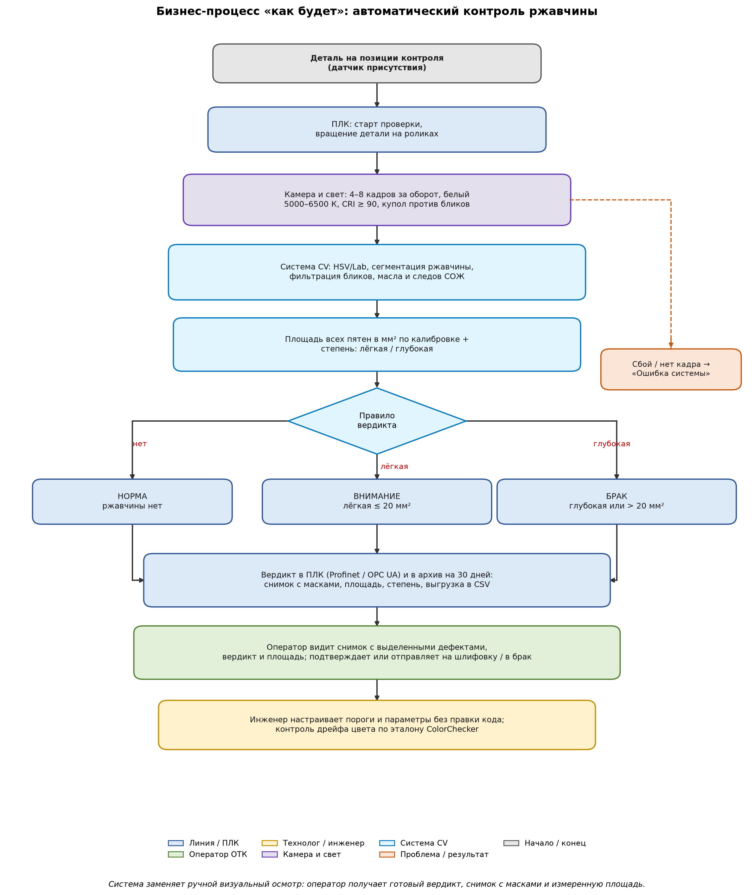
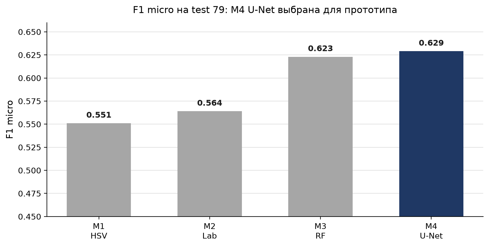

# КТ 5. Защита

**ТЗ 1. Система обнаружения ржавчины и коррозии (ПАО «ЧКПЗ»)**

| Поле | Значение |
|---|---|
| Проект (ТЗ) | ТЗ 1. Система обнаружения ржавчины и коррозии (ПАО «ЧКПЗ») |
| Дата защиты | 19.11.2026 |
| Капитан | Райимжонов Абдусамад Тулкинович |
| Участники | Индивидуальная работа. Все этапы проекта выполняются самостоятельно |
| Репозиторий | https://github.com/RvadRA/rust-corrosion-detection |

## 1. Задача и бизнес-процесс

**Проблема.** После обработки цилиндр осматривает оператор ОТК: вручную, по сменам и при разном освещении. Мелкие пятна от 5 мм пропускаются, площадь не измеряется, фото и результат не сохраняются. Из-за этого нельзя проверить порог 20 мм², подтвердить спор с поставщиком и стабильно уложиться в такт линии. Повторный осмотр мастером добавляет субъективности и времени.

**Что заменяет система.** Ручной визуальный осмотр и повторный осмотр мастером. Камера снимает боковую поверхность и кромки, ML-сервис находит ржавчину, считает площадь и формирует вердикт. Оператор видит снимок с выделенными дефектами, а ПЛК получает сигнал `Норма` / `Внимание` / `Брак` / `Ошибка системы`.

**Как будет устроен процесс.**

1. Деталь останавливается на позиции контроля; камера делает 4–8 кадров за оборот или 3–4 камеры снимают по кругу.
2. U-Net строит маску ржавчины; система считает площадь в пикселях, при калибровке — в мм².
3. По правилу ТЗ формируется вердикт: нет ржавчины — `НОРМА`; только лёгкая и ≤ 20 мм² — `ВНИМАНИЕ`; глубокая или > 20 мм² — `БРАК`.
4. Результат сохраняется в архив на 30 дней, выгружается в CSV, сигнал уходит в ПЛК по OPC UA или Profinet.
5. Инженер настраивает пороги без правки кода, оператор разбирает спорные случаи, технолог смотрит статистику.

**Границы прототипа.** В КТ 4 реализован программный стек: ML + API + PostgreSQL + интерфейс + Docker. Камера, освещение, механика, ПЛК и линия не входят в прототип: для них подготовлены требования и план интеграции.

*Рис. 1. Бизнес-процесс «как будет»: система заменяет ручной осмотр, а решение уходит в ПЛК и архив.*

## 2. Что сравнили

Сравнение M1–M4 выполнено на одном замороженном test из КТ 3: 79 изображений, 256×256, бинарные маски «ржавчина / фон». Ostrava — 15, Virginia Tech — 44, Pipelines — 20. Пороги и early stopping настраивались только на val, VT в validation отсутствует.

| Метод | F1 micro | Dice macro | IoU macro | Ошибка площади | VT F1 | FPS (CPU) |
|---|---:|---:|---:|---:|---:|---:|
| M1. HSV-порог | 0,551 | 0,533 | 0,405 | 172 % | 0,496 | 201,5 |
| M2. Lab-порог | 0,564 | 0,534 | 0,406 | 125 % | 0,513 | 105,2 |
| M3. RandomForest цвет + текстура | 0,623 | 0,582 | 0,450 | 120 % | 0,567 | 10,6 |
| **M4. U-Net** | **0,629** | **0,585** | **0,452** | **122 %** | **0,612** | **17,6** |

*Рис. 2. M4 U-Net даёт лучший F1 micro и более ровное качество на трёх источниках.*

**Почему для прототипа выбрана M4 U-Net.** У неё лучший F1 micro (0,629) и Dice/IoU macro (0,585 / 0,452). M3 RandomForest отстаёт всего на 0,005 F1, но заметно хуже на Virginia Tech (0,567 против 0,612). U-Net лучше держит границы и площадь, не зависит от AGPL-лицензии YOLO и работает на CPU. M3 оставлен как интерпретируемый baseline, M1/M2 HSV/Lab — как быстрый fallback.

**Дополнительная проверка на публичной VT-выборке.** Отдельно собраны 200 пар Virginia Tech (44 официальных test + 156 train), DOI 10.7294/16624663.v2, CC0. На 44 test при 512×512 U-Net дал F1 micro 0,6129, IoU micro 0,4418, Dice macro 0,5364, IoU macro 0,4051, ошибку площади 1,0013. Это совпадает с VT-результатом КТ 3. Выборка не является приёмкой: VT — мосты и состояние конструкций, а не гильзы ЧКПЗ; 156 train-кадров пересекаются с обучением КТ 3, поэтому F1 0,6483 на них и 0,6415 на всех 200 — leakage, а не честная оценка.

## 3. Результат против критериев приёмки

| Критерий из ТЗ | Требование | Результат | Выполнено |
|---|---|---|---|
| Recall пятен от 5 мм | ≥ 98 % | 15,6 % (spot-level, IoU ≥ 0,5) | нет |
| Погрешность площади | ≤ ±15 % | 122 % (M4) | нет |
| Правильная степень «лёгкая / глубокая» | ≥ 95 % | не оценивалась: нет разметки степени | нет |
| Тест на 200 деталях (100 / 50 / 50) | 200 реальных деталей | 79 изображений, реальных деталей 0 | нет |
| Пропуск брака | ≤ 2 % | не оценивался | нет |
| Ложная отбраковка | ≤ 3 % | не оценивалась | нет |
| Время проверки | не больше такта линии | 17,6 FPS на CPU; такт не задан | не проверено |
| Вердикты | «Норма», «Внимание», «Брак», «Ошибка системы» | НОРМА / ВНИМАНИЕ / БРАК; сбой ML → HTTP 503 | частично |
| Архив | ≥ 30 дней | retention 30 дней; тест на записи 31 день | да |
| Выгрузка в CSV | есть | HTTP 200, UTF-8 BOM, разделитель `;` | да |
| Настройка порогов инженером | без правки кода | `MM_PER_PX` через `.env`; UI/API настройки нет | частично |
| Правило вердикта | 0 / 20 мм² / глубокая | 0 — норма; ≤ 20 — внимание; > 20 — брак; без калибровки — внимание | частично |
| Интеграция с ПЛК | Profinet или OPC UA | не реализована | нет |

**Итог.** Приёмка не пройдена. По ключевым критериям качества — recall пятен, площадь, степень, вердикт и 200 деталей — результат ниже требований ТЗ. Это диагностический уровень F1 ≈ 0,63, а не промышленная точность. Причины: доменный сдвиг (мосты и трубы вместо цилиндров), отсутствие чистых кадров и hard negatives, downsample до 256 px, обучение на CPU 12 эпох без предобученного энкодера.

**Что уже работает как инженерный прототип.**

- Путь «вход → результат» без ручных шагов: загрузка, инспекция, overlay, запись в журнал.
- Все 4 контейнера healthy; `/health` показывает `db=connected`, `ml=ready`, retention 30 дней.
- Валидация файлов: `.md` → 415, повреждённый JPEG → 400, лимит 32 МБ.
- CSV с UTF-8 BOM и разделителем `;` — все медиа URL отдают 200.
- ML down → 503 с понятным сообщением; после старта ML → снова ready.
- Retention проверен на синтетически состаренной записи: 404 и удаление upload/mask/overlay.
- `MM_PER_PX=0,1` → `area_mm2=6199,04`, `calibrated=true`, вердикт `БРАК`.
- Чистый старт подтверждён: Release v1.0.0-kt3, `fetch_weights.py`, SHA-256, `docker compose up --build`.

## 4. Демонстрация

Демо — 5–6 минут, чтобы осталось время на вопросы. Показываем не «красивую картинку», а полный путь и отказные сценарии.

| Сценарий | Что показываем | Ожидаемый результат | Статус |
|---|---|---|---|
| `docker compose ps` + `/health` | 4 контейнера, БД и ML | 4/4 healthy; `db=connected`, `ml=ready` | да |
| Загрузка `01.jpg` через UI | Результат, overlay, журнал | `ВНИМАНИЕ`, `area_px=619904`, `confidence=0,7307`, `area_mm2=null` | да |
| `MM_PER_PX=0,1` | Калиброванная площадь и вердикт | `area_mm2=6199,04`, `calibrated=true`, `БРАК` | да |
| `GET /api/v1/results.csv` | Выгрузка журнала | 200, UTF-8 BOM, `;`, 4 строки | да |
| ML down | Отказ ML-сервиса | 503 с понятным сообщением; после старта ML → healthy | да |
| Retention 30 дней | Состаренная запись | 404; upload/mask/overlay удалены | да |
| Чистый старт | Release + веса + compose | SHA-256 совпал; 4 контейнера healthy | да |

**Порядок показа.**

1. `docker compose ps` и `curl http://localhost:8000/health` — фиксируем, что стенд живой.
2. В UI загружаем `01.jpg`; показываем overlay, вердикт, площадь, уверенность и запись в журнале.
3. Открываем CSV; показываем BOM и разделитель.
4. В терминале останавливаем ML, повторяем инспекцию → 503; поднимаем ML → healthy.
5. Показываем retention на состаренной записи или заранее сделанный скриншот.
6. Возвращаемся к выводу: прототип технически работает, качество модели — нет.

**Запасное видео.** [Скачать backup-видео демо](demo_backup.mp4). Если Docker не поднимается на защите, показываем видео и скриншоты, а не тратим время на починку.

## 5. Рекомендация заказчику

**Что внедрять.** U-Net M4 как baseline для пилота, а не как готовую промышленную модель. Рядом оставить HSV/Lab fallback и RandomForest M3 для сравнения и объяснимости. YOLOv8-seg не внедрять без коммерческой лицензии: AGPL-3.0 требует раскрытия кода сетевого сервиса. SegFormer-B0 не внедрять до проверки лицензии весов NVIDIA. Для степени «лёгкая / глубокая» нужна отдельная голова и разметка.

**Какое железо нужно.**

| Компонент | Рекомендация |
|---|---|
| Камера | Цветная 5 МП, глобальный затвор, GigE; ≤ 0,2 мм/пиксель |
| Съёмка | 4–8 кадров за оборот на роликах или 3–4 камеры по кругу |
| Свет | 5000–6500 К, CRI ≥ 90, рассеянный купол, защита от бликов |
| Защита | IP65 для камер и света, защита от пыли, СОЖ и вибрации |
| Вычисления | Edge-сервер или ПК с CPU; для линии — GPU/ускоритель; 16 ГБ RAM |
| Хранение | 30 дней архива, резервное копирование media |
| Интеграция | OPC UA или Profinet, триггер камеры, сигналы вердикта |

**Что доработать перед внедрением.**

1. Снять 300 чистых кадров и 20–50 реальных деталей с дефектами; добавить блики, масло, СОЖ и царапины как hard negatives.
2. Обучить модель на нативном разрешении или crop'ах 512–1024 px, взять предобученный энкодер, GPU, больше эпох и TTA.
3. Добавить голову степени, калибровку мм/пиксель по эталону и проверку на 200 деталях (100 / 50 / 50).
4. Реализовать настройку порогов в UI/API, а не только через `.env`.
5. Интегрировать камеру, свет и ПЛК; проверить такт линии и поведение при сбое.
6. Добавить аутентификацию, TLS, резервное копирование и минимальный мониторинг.

**Рекомендация.** Не внедрять в линию до приёмки. Запускать пилот на 20–50 деталях параллельно с оператором, собирать ошибки и только после стабильного recall и площади расширять на 200 деталей. Текущий результат полезен как основа и как честный baseline, но не как замена ОТК.

## 6. Вклад участников

| Участник | Что сделал за проект |
|---|---|
| Райимжонов Абдусамад Тулкинович | Анализ ТЗ и вопросы заказчику; бизнес-процессы «как есть» / «как будет»; обзор 11 источников; подготовка данных Ostrava / VT / Pipelines; M1–M4, U-Net, метрики и аудит; публичная VT-выборка; FastAPI, PostgreSQL, React, Docker Compose; отчёты КТ 1–5 и презентация. Внешних участников нет — индивидуальная работа. |

## 7. Презентация (10 минут)

| № | Слайд | Время |
|---|---|---:|
| 1 | Задача и команда | 1,0 мин |
| 2 | Бизнес-процесс «как есть» и «как будет» | 1,5 мин |
| 3 | Данные и методы | 1,5 мин |
| 4 | Сравнение моделей | 1,5 мин |
| 5 | Прототип и живое демо | 2,5 мин |
| 6 | Результаты против критериев приёмки | 1,0 мин |
| 7 | Рекомендация заказчику | 0,5 мин |
| 8 | Вывод и вопросы | 0,5 мин |

Файл презентации: `docs/kt5/КТ 5. Презентация.pptx`. Главная мысль: прототип технически работает, но модель не прошла приёмку; внедрять можно только пилотом после сбора своих данных.

## Чек-лист сдачи

- ☒ Сдано всё из раздела «Что сдать» своего ТЗ — отчёт, презентация и backup-видео готовы.
- ☒ Итоговый отчёт, презентация и backup-видео в репозитории.
- ☒ Код запускается по README — подтверждено 19.11.2026: 4 контейнера healthy, health, CSV, медиа.
- ☒ Демо проверено, есть запасное видео — `demo_backup.mp4` записано.
- ☒ Каждый участник готов ответить на вопросы по своей части — индивидуальная работа, материал в отчёте.

## Приложение. Короткие ответы на вопросы

- **Почему recall 15,6 %, а не 98 %?** Пятна 5 мм при downsample до 256 px теряют пиксели; модели обучены на мостах и трубах, а не на цилиндрах; нет чистых кадров и hard negatives. Нужны нативное разрешение, свои данные и приёмочный тест.
- **Почему F1 0,63 — это плохо?** F1 pixel-level завышен крупными пятнами. На уровне пятен recall ещё ниже. Для ТЗ важен именно recall пятен от 5 мм и площадь, а не средний F1 по пикселям.
- **Почему U-Net, а не YOLO?** U-Net дал лучший F1 и более ровный результат на трёх источниках; YOLO не запускался и требует AGPL-лицензию. YOLO остаётся кандидатом на edge-инференс после проверки.
- **Почему VT не в validation?** В validation 35 изображений, VT там нет; пороги и early stopping на VT не настраивались. VT — только test. Публичная VT200 подтвердила результат, но не заменила приёмку.
- **Почему в журнале 4 записи, а не 200?** Это демонстрационные записи прототипа. Приёмочный тест на 200 реальных деталях не проводился — нет данных заказчика.
- **Можно ли внедрять?** Нет. Только пилот на 20–50 деталях параллельно с оператором, после сбора данных и повторной приёмки.
